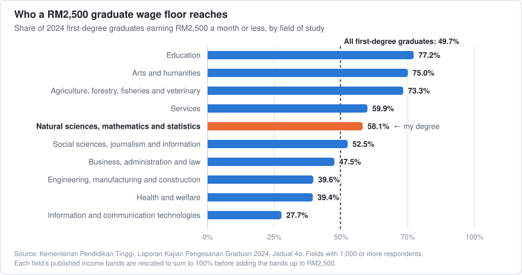

<picture>
<source media="(prefers-color-scheme: dark)" srcset="assets/header-dark.svg">

</picture>

[Portfolio](https://downey112.github.io) · [LinkedIn](https://linkedin.com/in/luqmansyahrulnizam) · Open to graduate AI Engineer roles from March 2027

In a regression, the **residual** is what's left after the model has said everything it can. That's the part I like: take a headline number, find the public data behind it, and see what the average leaves out.

I'm a final-year **B.Sc. (Hons.) Statistics** student at UiTM, graduating in February 2027, and currently a Business Analyst intern at Alto Soft Sdn Bhd (Oct 2026 – Feb 2027). There I wrote the user requirements specification and the 235-case UAT scripts for a government system's v2, found an HTTP 500 bug during UAT, retest developer fixes against their Jira tickets, and write user manuals and SOPs. Most of what's here is built on Malaysian open data—[OpenDOSM](https://open.dosm.gov.my/), the Ministry of Higher Education, MetMalaysia, and the federal Budget documents—alongside LLM agents and RAG services with measured evals, plus production-style pricing, survival, and streaming pipelines.

**Open to full-time graduate AI Engineer roles in Kuala Lumpur and the Klang Valley, available from March 2027.** Reach me on [LinkedIn](https://linkedin.com/in/luqmansyahrulnizam) or see the write-ups on my [portfolio](https://downey112.github.io).

<table>
<tr>
<td align="center" width="25%"><h2>49.7%</h2>of 2024 graduates already at or below the new <b>RM2,500</b> wage floor</td>
<td align="center" width="25%"><h2>16.6M</h2>retail prices scanned for weekly profiteering leads</td>
<td align="center" width="25%"><h2>50,000</h2>simulated MPL S18 playoff brackets</td>
<td align="center" width="25%"><h2>155</h2>placebo dates behind every KL rail event claim</td>
</tr>
</table>

## AI engineering

| The question | What the data said | Built with |
| ----- | ----- | ----- |
| Can an agent read a Bursa Malaysia filing without inventing numbers? | Rules-first extraction over **11 real quarterly filings**, with an accounting-identity guardrail (assets = liabilities + equity): **8 correct, 3 safely refused for review, 0 wrong numbers reported as ok**. [**bursa-filing-agent**](https://github.com/Downey112/bursa-filing-agent) | Python, LangGraph, MCP |
| What does the Budget actually say? | v2 answers from the official Budget 2026 and 2027 documents with page-level citations and refusal guardrails: hybrid + rerank retrieval reaches **recall@5 0.971** on 34 golden questions, against **0.794** for v1's vector-only search. [**belanjawan-bot**](https://github.com/Downey112/belanjawan-bot) · [**live**](https://belanjawan-bot-ut48esxousutb5xbp8ehqz.streamlit.app/) | Python, RAG, Streamlit, FastAPI |
| Can RAG search find an answer inside a datasheet pin table? | Table-aware chunking keeps pin and register tables intact: the answer lands in the top 5 for **20 of 30** golden questions vs **13 of 30** for plain page text, on the same retriever. [**semicon-datasheet-rag**](https://github.com/Downey112/semicon-datasheet-rag) · [**live API**](https://semicon-datasheet-rag.onrender.com/docs) | Python, RAG, FastAPI |
| Can a general agent hold up on a benchmark? | Hugging Face Agents Course final agent (**85%** on GAIA Level-1 questions). [**hf-agents-course-gaia**](https://github.com/Downey112/hf-agents-course-gaia) | Python, smolagents |
| Can one worker stretch across free AI models? | MCP worker for Claude Code that routes tasks across free AI models and falls back when one hits its quota. [**free-worker**](https://github.com/Downey112/free-worker) | Python, MCP |
| Can an AI assistant read Threads without write access? | Read-only Threads API connector for topic analysis. [**threads-mcp**](https://github.com/Downey112/threads-mcp) | Python, MCP |

## One finding, drawn

Budget 2027 announced a **RM2,500 monthly wage floor** for graduates. Half of 2024's first-degree graduates were already at or below it (`49.7%`), but that half is not spread evenly across disciplines:

<picture>
<source media="(prefers-color-scheme: dark)" srcset="assets/graduate-floor-dark.svg">

</picture>

The numbers behind the chart live in [data/](data/graduates_at_or_below_rm2500.csv), and the full microsimulation is in [**fresh-grad-salary-model**](https://github.com/Downey112/fresh-grad-salary-model).

## Flagship investigations

1. [**fresh-grad-salary-model**](https://github.com/Downey112/fresh-grad-salary-model) **— How many graduates does a RM2,500 wage floor reach, and what does it cost?**

   `49.7%` of 2024 first-degree graduates earned RM2,500 or less. In simulation, the graduate wage bill rises **7.1% to 14.4%**, depending on who is covered and how spillover behaves. *(Python, statsmodels, Excel)*

2. [**pricecatcher-retail-pricing**](https://github.com/Downey112/pricecatcher-retail-pricing) **& [pricecatcher-anomaly](https://github.com/Downey112/pricecatcher-anomaly) — Store-format pricing and weekly profiteering leads across 20M+ prices**

   A 16-staple basket is **14% cheaper** in hypermarkets (`RM110.96`) than wet markets (`RM126.58`) under two-way fixed effects, though within-format shop dispersion dominates. To shortlist weekly inspections across 16.6M prices (Jan–Oct 2026) without profiteering labels, planted `+20%` markups served as the benchmark: a simple peer-grouped **robust z-score caught 21%** of held spikes at top-20/district capacity vs **9–11%** for Isolation Forest and ECOD. *(DuckDB, Python, scikit-learn, Power BI)*

3. [**hr-attrition-decision**](https://github.com/Downey112/hr-attrition-decision) **— Who quits a job, and is it worth paying to keep them?**

   Real survey data on `1,116` employees shows staff on partly undeclared ("grey") pay stay a median **26 months vs 54**. A Cox model ranks risk modestly (`C-index 0.60`), and back-testing the retention cost rule beats "treat nobody" or "treat everybody" in just **4 of 45 cost scenarios**—meaning treatment-effect estimation matters more than the model. *(Python, lifelines, Power BI)*

4. [**ev-conformal**](https://github.com/Downey112/ev-conformal) **— How honest is a published paper's "90% range"?**

   Re-examining [arXiv:2610.13588](https://arxiv.org/abs/2610.13588) on EV charging uncertainty: an honest calibrated method would pass only **~53%** of the paper's scorecard, so its recommended method wins by being wider. Three code discrepancies were identified and reported to the authors. *(Python, conformal prediction)*

## Questions I've put to the data

### Malaysian Public Data & Policy

| The question | What the data said | Built with |
| ----- | ----- | ----- |
| Which fields of study leave graduates most exposed? | Every field had **88%+** of its labour-force graduates in work in 2025; the fields differ far more in job quality. Services, Agriculture, Education, and Arts sit at the risky end. [**program-risk-my**](https://github.com/Downey112/program-risk-my) · [**live**](https://programriskmy.streamlit.app/) | Python, Streamlit |
| What does a graduate hire cost an employer at the new benchmarks? | Statutory employer cost and take-home pay at `RM2,000`, `RM2,500`, and `RM3,400` a month, in a formula-driven workbook. [**belanjawan-2027-wage-cost-model**](https://github.com/Downey112/belanjawan-2027-wage-cost-model) | Excel, Python |
| Which months of Malaysian trade don't fit the pattern? | **320 months** of OpenDOSM trade data, with **8 export anomaly months** and **25 sector spikes** flagged. [**dosm_trade_engine**](https://github.com/Downey112/dosm_trade_engine) | Python, pandas, Power BI |
| How far is the market fuel price from the subsidised one this week? | Live tracker of the unsubsidised gap for RON95 and diesel, refreshed twice a week. [**budi-pulse**](https://github.com/Downey112/budi-pulse) · [**live**](https://budi-pulse.streamlit.app) | Python, PostgreSQL, Streamlit |
| Did fares and network changes move KL rail riders? | Daily data.gov.my ridership on seven Klang Valley lines, six events, each checked against placebo dates, the level just before, and a comparison line: the 2022 free month lifted Ampang **+19%**, MRT Kajang **+30%**, and the Monorail **+34%**; LRT Shah Alam lost **4 in 10** weekday riders when its free rides ended; the Monorail gained **16%** while Kelana Jaya was shut. The My50 pass still can't be measured. [**lrt-ridership-events**](https://github.com/Downey112/lrt-ridership-events) | Python, Power BI |
### Retail, Demand & Decision Systems

| The question | What the data said | Built with |
| ----- | ----- | ----- |
| Can store sales be forecast as they stream in? | Real M5 Walmart demand replayed through Kafka and Spark as a live stream (stock, costs, and transaction lines **simulated**). Next-day WAPE was **0.725** on the replay, close to the **0.710** backtest of the champion random forest (seasonal naive: `0.868`). [**retail-demand-rt**](https://github.com/Downey112/retail-demand-rt) · [**dashboard**](https://downey112.github.io/retail-demand-rt/dashboard/) | Kafka, PySpark, Power BI |
| Which online shoppers are about to leave, and what do they buy together? | Real UCI Online Retail II data (`4,350` active customers in the held-out month): a logistic model ranks 30-day churn with **AUC 0.755** vs **0.684** for recency alone (probabilities need holiday recalibration). Apriori finds **249 bundle rules**, cross-checked in SQL. [**ecom-churn-basket**](https://github.com/Downey112/ecom-churn-basket) | PostgreSQL, Python |
| Do marketing-mix methods recover the truth? | A **simulation study** with known true parameters: promo lifts and the profit-optimal budget are recovered well across `100` Monte Carlo runs, while the response curve's ceiling is weakly identified. [**Multi-Channel ROI**](https://github.com/Downey112/Multi-Channel-Retail-Demand-Forecasting-Marketing-ROI-Optimizer) | PostgreSQL, statsmodels |
| Who wins MPL Malaysia Season 18 (Mobile Legends)? | The `56` regular-season results (checked against Liquipedia) feed Elo, Bradley-Terry, and a logistic model across **50,000 simulated playoff brackets**: SRG win the title in **62.9%** of runs and take an M8 slot in **86.9%**. Season-average features leak the outcome, so the fair bar is pre-match Elo (`AUC 0.675`). [**mpl-my-s18-ml-predictor**](https://github.com/Downey112/mpl-my-s18-ml-predictor) | Python, NumPy, Power BI |
| Who leaves a telco, and when? | `26.54%` churn across `7,043` customers; month-to-month contracts are **88.55%** of those who left. [**DSC651-TelcoChurn-PowerBI**](https://github.com/Downey112/DSC651-TelcoChurn-PowerBI) | Power BI |
| Can a model catch fraud that is 0.17% of transactions? | SMOTE-resampled detection pipeline for a heavily imbalanced dataset. [**audit-fraud-detection**](https://github.com/Downey112/audit-fraud-detection) | Python, SQL |

### Other Tools & Pipelines

* [**malaysia-inclusive-economy-blueprint**](https://github.com/Downey112/malaysia-inclusive-economy-blueprint) · [**live**](https://Downey112.github.io/malaysia-inclusive-economy-blueprint/) — Interactive fiscal policy simulator.

* [**perasaan-malaysia**](https://github.com/Downey112/perasaan-malaysia) — Scheduled pipeline for MetMalaysia's 7-day forecasts.

* [**esg-multiagent-auditor**](https://github.com/Downey112/esg-multiagent-auditor) — Event-driven Scope 1–3 GHG auditing architecture.

* [**wealthwatch**](https://github.com/Downey112/wealthwatch) · [**live**](https://wealthwatch-six.vercel.app) — Personal finance tracker.

Every empirical claim above links to its underlying repository, data pipeline, or live dashboard. Whenever synthetic or simulated variables are used alongside real datasets (such as inventory costs in [`retail-demand-rt`](https://github.com/Downey112/retail-demand-rt) or ground-truth parameters in [`Multi-Channel ROI`](https://github.com/Downey112/Multi-Channel-Retail-Demand-Forecasting-Marketing-ROI-Optimizer)), they are explicitly labelled as **simulated**.

## What I work in

| Layer | Tools & Methods |
| ----- | ----- |
| **AI & LLM** | LLM agents (LangGraph, smolagents), MCP servers, RAG with hybrid BM25 + vector retrieval and reranking, pgvector, retrieval evals (recall@k) in CI |
| **Statistical Methods** | Multiple linear & fixed-effects regression, survival analysis (`lifelines`), conformal prediction, Monte Carlo simulation, hypothesis testing, regression diagnostics, anomaly detection |
| **Analysis & Data** | Python (`pandas`, `statsmodels`, `scikit-learn`, `NumPy`), R, SQL (PostgreSQL, T-SQL, DuckDB), PySpark, Kafka, SAS, SPSS |
| **Reporting & Apps** | Power BI (DAX, star schemas), Excel, Streamlit, Tableau, Looker Studio |
| **Build & Deploy** | FastAPI, Docker, GitHub Actions, Vercel, Supabase, JavaScript, TypeScript, HTML |


```
                        Model summary: luqman
======================================================================
Dep. variable:   answers you can check
Method:          least squares
Sample:          Oct 2023 - Feb 2027, B.Sc. (Hons.) Statistics, UiTM
Current:         Business Analyst intern, Alto Soft Sdn Bhd (Oct 2026 - Feb 2027)
----------------------------------------------------------------------
Notes:
[1] Every number comes from a linked repository or from GitHub.
[2] Simulated data is labelled as simulated.
[3] The header and chart are drawn by scripts/build_assets.py;
    the activity image is refreshed daily by lowlighter/metrics.
======================================================================

```
