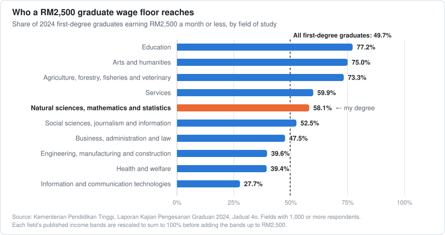

<picture>
  <source media="(prefers-color-scheme: dark)" srcset="assets/header-dark.svg">
  
</picture>

In a regression, the **residual** is what's left after the model has said everything it can.
That's the part I like: take a headline number, find the public data behind it, and see what
it leaves out.

I'm a final-year Statistics student at UiTM, and most of what's here is built on Malaysian
open data: OpenDOSM, the Ministry of Higher Education, MetMalaysia and the Budget documents.

**Looking for a Data Analyst internship in Kuala Lumpur, available now until January 2027.**
&nbsp;[LinkedIn](https://linkedin.com/in/luqmansyahrulnizam) · [Portfolio](https://the-residual-lilac.vercel.app)

## One finding, drawn

Budget 2027 announced a RM2,500 wage floor for graduates. Half of 2024's first-degree
graduates were already at or below it, but that half is not spread evenly.

<picture>
  <source media="(prefers-color-scheme: dark)" srcset="assets/graduate-floor-dark.svg">
  
</picture>

The numbers behind the chart are in [`data/`](data/graduates_at_or_below_rm2500.csv), and the
full analysis is in [fresh-grad-salary-model](https://github.com/Downey112/fresh-grad-salary-model).

## Questions I've put to the data

| The question | What the data said | Built with |
|---|---|---|
| How many graduates does a RM2,500 wage floor reach, and what does it cost? | 49.7% earned RM2,500 or less in 2024. In simulation the graduate wage bill rises 7.1% to 14.4%, depending on who is covered. [fresh-grad-salary-model](https://github.com/Downey112/fresh-grad-salary-model) | Python, statsmodels, Excel |
| What does a graduate hire cost an employer at the new wage benchmarks? | Employer cost and take-home pay at RM2,000, RM2,500 and RM3,400 a month, in a formula-driven workbook. [belanjawan-2027-wage-cost-model](https://github.com/Downey112/belanjawan-2027-wage-cost-model) | Excel, Python |
| Which months of Malaysian trade don't fit the pattern? | 320 months of OpenDOSM trade data, with 8 export anomaly months and 25 sector spikes flagged. [dosm_trade_engine](https://github.com/Downey112/dosm_trade_engine) | Python, pandas, Power BI |
| How far is the market fuel price from the subsidised one this week? | A live tracker of the gap for RON95 and diesel, refreshed twice a week. [budi-pulse](https://github.com/Downey112/budi-pulse) · [live](https://budi-pulse.streamlit.app) | Python, PostgreSQL, Streamlit |
| Who leaves a telco, and when? | 26.54% churn across 7,043 customers; month-to-month contracts are 88.55% of those who left. [DSC651-TelcoChurn-PowerBI](https://github.com/Downey112/DSC651-TelcoChurn-PowerBI) | Power BI |
| Can a model catch fraud that is 0.17% of transactions? | A detection pipeline for a heavily imbalanced dataset. [audit-fraud-detection](https://github.com/Downey112/audit-fraud-detection) | Python, SQL |
| What does the Budget actually say? | Answers drawn from the official Budget 2026 documents, with page-level citations. [belanjawan-bot](https://github.com/Downey112/belanjawan-bot) | Python, RAG |

Also here: [perasaan-malaysia](https://github.com/Downey112/perasaan-malaysia), a scheduled
pipeline for MetMalaysia's 7-day forecasts; [malaysia-inclusive-economy-blueprint](https://github.com/Downey112/malaysia-inclusive-economy-blueprint) · [live](https://Downey112.github.io/malaysia-inclusive-economy-blueprint/), an interactive fiscal policy simulator; [esg-multiagent-auditor](https://github.com/Downey112/esg-multiagent-auditor), an event-driven Scope 1-3 GHG auditing architecture; and [wealthwatch](https://github.com/Downey112/wealthwatch), a personal finance tracker that is [live](https://wealthwatch-six.vercel.app).

## What I work in

**Analysis** Python (pandas, statsmodels), R, SQL (PostgreSQL, T-SQL), SAS, SPSS<br>
**Reporting** Power BI (DAX, star schemas), Excel, Tableau, Looker Studio, Streamlit<br>
**Methods** multiple linear regression, hypothesis testing, regression diagnostics, anomaly detection

```
                        Model summary: luqman
======================================================================
Dep. variable:   answers you can check
Method:          least squares
Sample:          Oct 2023 - Feb 2027, B.Sc. (Hons.) Statistics, UiTM
----------------------------------------------------------------------
Notes:
[1] Every number on this page comes from a repository linked above.
[2] Simulated data is labelled as simulated.
[3] The header and chart are drawn by scripts/build_assets.py.
======================================================================
```
